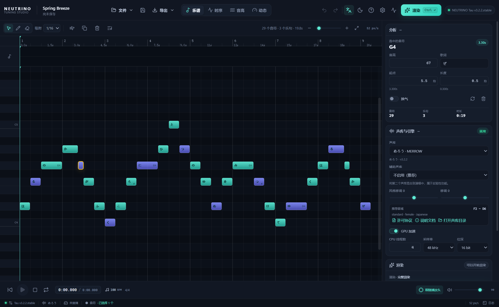
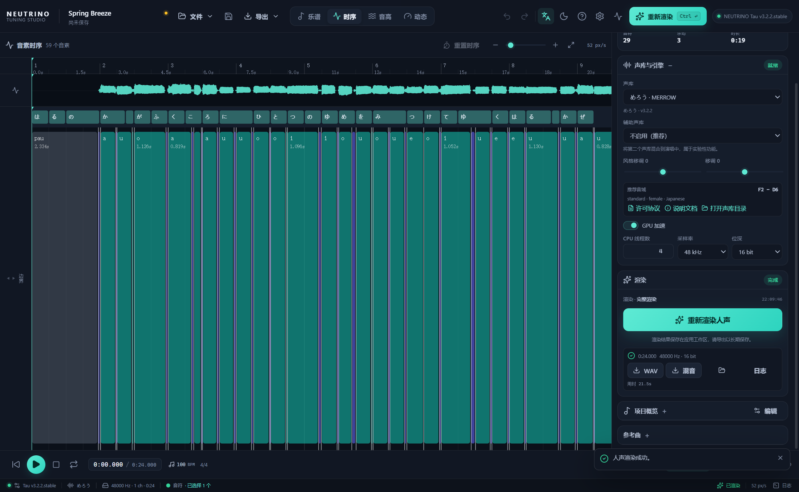
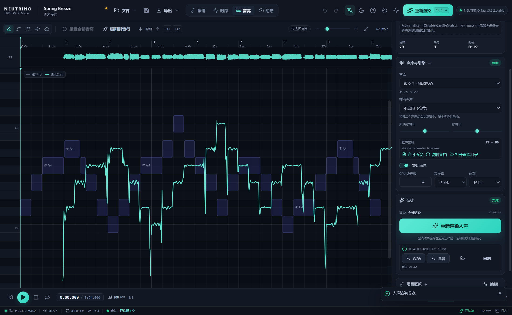
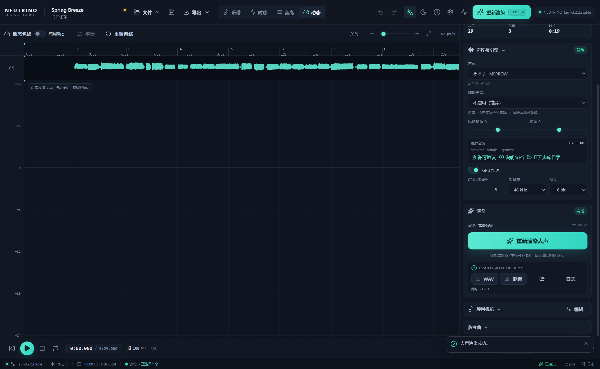

# NEUTRINO Tuning Studio

面向 **NEUTRINO Tau** 的跨平台调声工作台。用钢琴卷帘编辑乐谱，渲染一次后直接调整音素时序、F0 音高曲线与输出动态；无需手写命令行，也不需要外部调声工具。

> 非官方配套程序，与 SHACHI / STUDIO NEUTRINO 无隶属或背书关系。NEUTRINO 引擎与歌声库需单独安装，并遵守各自的许可协议。



| 时序 Timing | 音高 Pitch | 动态 Dynamics |
| --- | --- | --- |
|  |  |  |

## 功能

- **乐谱编辑**：钢琴卷帘绘制/移动/缩放音符；画笔可拖动决定音符长度，橡皮可拖动连续擦除；假名歌词批量编辑、罗马字转假名、换气记号、小节/速度/拍号、MusicXML 导入导出、MIDI 导入。
- **重叠提示**：出现单声部重叠时，卷帘顶部显示警告，相关音符以红色描边标出。
- **音素时序**：直接拖动 `timing.lab` 音素边界，重新渲染时使用编辑后的时序。
- **音高调声**：绘制 F0 曲线、直线、平滑、颤音、移调、按音符自动修正；修改通常只需重新运行声码器，比完整渲染更快。
- **动态包络**：按时间绘制 dB 包络，应用于试听和导出（人声或混音）。
- **渲染管理**：自动检测 NEUTRINO 与歌声库，选择主/辅助声库、StyleShift、移调、线程、GPU、采样率、位深；实时进度与日志；取消渲染。
- **增量重渲染（实验性）**：已支持按阶段复用 `timing/F0/melspec`；修改音高时会在条件允许的情况下自动只重渲染受影响的乐句，再拼接回整曲；无法安全处理时回退为完整渲染。时序或乐谱修改仍使用完整渲染。实现细节与限制见 [增量渲染说明](docs/INCREMENTAL-RENDERING.md)。
- **工程与音频**：`.ntstudio` 工程保存乐谱、时序、F0、动态、参考曲与渲染记录；参考曲试听/对齐；WAV/混音导出；播放、循环、缩放、自动跟随。
- **跨平台与三语**：Windows、macOS、Linux 构建配置；中文/英文/日文完整界面。
- **纵向卷帘滚动**：音符行高固定，底栏展开不会压扁卷帘；滚轮与 Shift+滚轮分别控制两轴，可在设置中切换“水平优先/纵向优先”。

## 快速开始

1. 安装 **NEUTRINO Tau**（v3.x），记下包含 `Run.bat` / `Run.sh` 与 `model` 文件夹的目录。
2. 启动本程序。首次启动会自动检测 NEUTRINO；也可以手动选择目录。
3. 打开示例曲，或新建项目 / 导入 MusicXML。
4. 在右侧选择声库，点击“渲染人声”。
5. 依次在“时序”“音高”“动态”中调声，再次渲染。
6. 从右侧渲染卡片或“导出”菜单导出 WAV / 混音 / MusicXML。

默认快捷键：`Space` 播放/暂停，`Ctrl+Enter` 渲染，`Ctrl+S` 保存，`Ctrl+Z` 撤销，`Ctrl+1…4` 切换编辑页，`Ctrl+滚轮` 时间轴缩放。

## 安装包

构建产物位于 `release/`：

- Windows：NSIS 安装包 + `portable` 绿色版
- Linux：AppImage + deb
- macOS：本地交叉构建的 arm64 预览 zip 位于 `release/mac/`（ad-hoc 签名，**未在 macOS 实机验证**，不建议作为正式发布包）。`release/` 不随仓库提交；如需公开预览，请发布到 GitHub Releases。原生 dmg 可用 [macOS 构建说明](docs/MACOS.md) 中的 GitHub Actions 或 Mac 构建。

应用本身为 MIT 许可。**不包含** NEUTRINO 可执行文件、歌声库或任何模型权重。

## 开发

要求 Node.js 22+。

```bash
npm install
npm run dev        # Vite + Electron 开发模式
npm run build      # 类型检查 + 渲染进程构建
npm test           # Vitest 单元测试
npm run icon       # 从品牌素材重新生成 PNG/ICO/各尺寸图标
npm run dist:win   # Windows 安装包
npm run dist:linux # Linux AppImage/deb
npm run dist:mac   # macOS dmg（需在 macOS 上执行）
```

主要目录：

```
electron/           主进程、预加载脚本、NEUTRINO 进程管理、设置存储
src/components/     React 界面与四种编辑器
src/lib/            乐谱/MusicXML/MIDI/F0/时序/音频/工程格式
src/state/          Zustand 应用状态与渲染编排
docs/               集成说明、架构、测试报告、截图
scripts/            本地验证与截图脚本
```

### NEUTRINO 调用方式

本程序复用官方 CLI，不修改引擎：

```text
musicXMLtoLabel.exe score.musicxml full.lab mono.lab
neutrino.exe full.lab timing.lab output.f0 output.melspec output.wav model/MERROW \
  -n 4 -k 0 -f 0 -s 48000 -b 16 -t -m
```

真实引擎相关的 UI 端到端脚本（需要本地安装 NEUTRINO）：`npm run test:e2e:win`；调声与播放回归测试：`npm run test:e2e:ui`；局部重渲染回归：`npm run test:e2e:phrase`；WSL/Linux 界面冒烟测试：`npm run test:e2e:linux`。截图可用 `npm run screenshots` 重生成。

调声重渲染只使用必要的跳过参数：

- 只改音高：`--skip-timing --skip-f0 --skip-melspec`（直接读取已有 `timing.lab` 和编辑后的 `output.f0`，只跑声码器）
- 改时序：`--skip-timing`（读取编辑后的 `timing.lab`，重做声学特征；若有音高编辑，再按时间映射保留并重跑声码器）

`f0` 为 100 fps 的 float32 频率数组；`timing.lab` 为 `开始 结束 音素`（100 ns 单位）文本。详细说明见 [docs/NEUTRINO-INTEGRATION.md](docs/NEUTRINO-INTEGRATION.md)。

### 平台说明

- **Windows**：原生运行官方 Windows 版。完整渲染、时序/音高/动态编辑、工程保存与导出已在 Windows 11 + NVIDIA GPU + Tau v3.2.2 环境验证；详细环境与结果见[测试报告](docs/TEST-REPORT.md)。
- **Linux**：官方提供 Linux（Ubuntu）/在线版，可将设置中的执行模式设为“原生”；如果使用 Windows 版，则设为 Wine。界面已在 WSL2 + WSLg 环境完成基本验证；原生引擎尚未在 Linux 实机验证（见测试报告）。
- **macOS**：官方提供 Apple Silicon 版，选择其目录并使用“原生”即可。macOS 构建与运行尚未在实机验证。

## 已知限制

- VST3/CLAP 插件（可选第二阶段）尚未包含。
- 和声、多个声部或和弦会被归约为单旋律；`score-timewise` MusicXML 不支持。导入后会给出提示。
- 改动乐谱或速度/拍号会使已有时序/F0 失效，需要重新完整渲染；改时序时会尝试保留音高编辑。
- 动态包络是输出增益包络，不是重训练/重推断声学模型。
- 参考曲仅用于试听与混音导出，不会提交给 NEUTRINO 引擎。

## 许可与致谢

- 本程序：MIT，见 [LICENSE](LICENSE)。
- 品牌标志“TS for NEUTRINO”由项目作者制作，以 MIT 许可随项目发布，不单独限制商用。字母使用 MiSans SemiBold；MiSans 按小米的独立字体许可允许免费商用，详见 [MiSans 官方许可说明](https://hyperos.mi.com/font/en/faq/)。图标按尺寸使用 TS / TS for / 完整字标三种裁切，采用最近邻缩放。详见 [THIRD_PARTY_NOTICES.md](THIRD_PARTY_NOTICES.md)。
- NEUTRINO 与歌声库：© SHACHI / STUDIO NEUTRINO 及各权利人；使用、发布作品前请阅读对应的最终用户许可协议（EULA）与歌声库许可。
- Electron、React、Vite、Zustand、i18next、fast-xml-parser、pako、midi-file、lucide-react 等开源项目。

更多文档：[NEUTRINO 集成说明](docs/NEUTRINO-INTEGRATION.md) · [架构](docs/ARCHITECTURE.md) · [测试报告](docs/TEST-REPORT.md) · [增量渲染调研](docs/INCREMENTAL-RENDERING.md) · [macOS 构建](docs/MACOS.md) · [VST3 路线图](docs/VST3-ROADMAP.md)。
