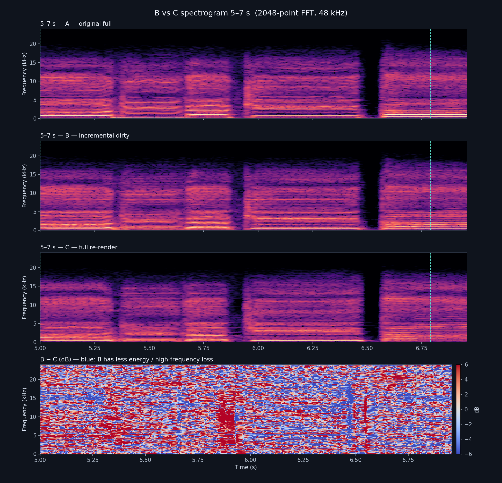
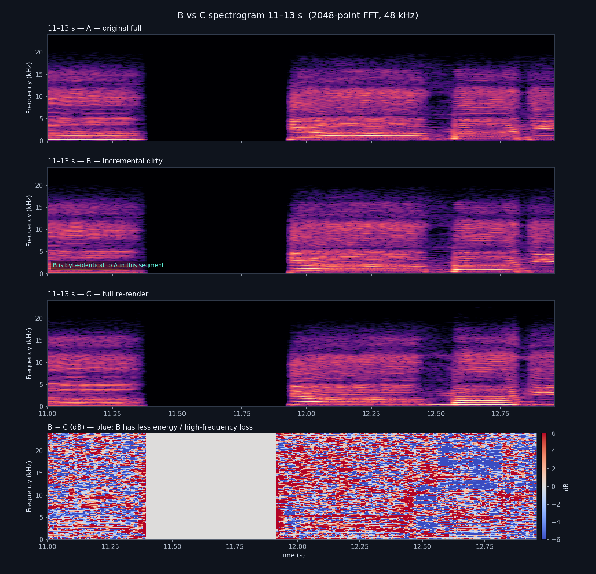
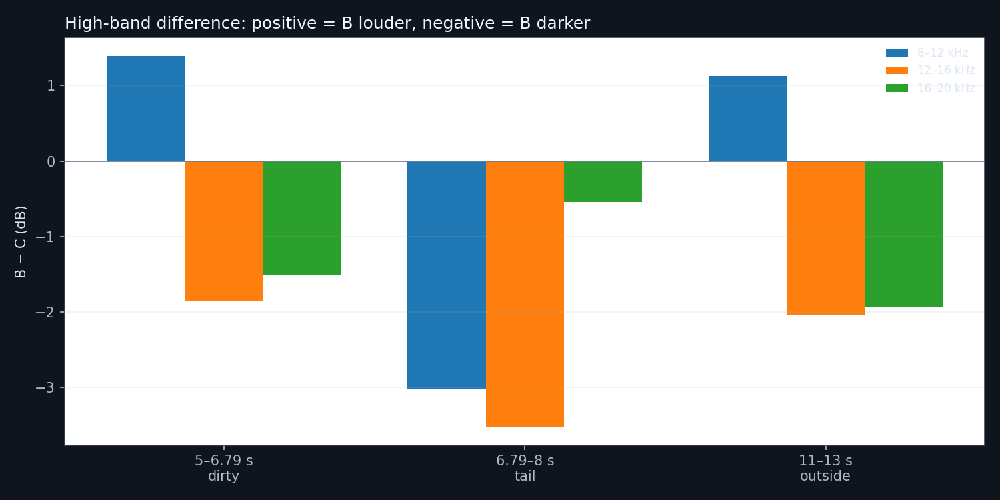

# 脏区重渲染试听对比

实验分支：`experiment/dirty-region`  
素材：`sample1.musicxml`，43.2 s，48 kHz / 16-bit / mono。

## 版本

| 文件 | 内容 |
|---|---|
| `A-original-full.wav` | 修改前的完整渲染 |
| `B-incremental-full.wav` | 修改音高后的脏区增量渲染 |
| `C-full-rerender-full.wav` | 相同最终 F0/时序状态下重新完整渲染 |
| `A/B/C-...-context.wav` | 3.50–8.00 s 的对比片段 |
| `compare-context-ABC.wav` | 同一片段按 A → 0.5 s 静音 → B → 0.5 s 静音 → C 拼接 |

脏区窗口为 **5.00–6.79 s**（frames 500–679）。片段前后各约 1.5 s 上下文。
截取片段首尾加了 10 ms 淡入/淡出，避免试听时因切点产生爆音；完整轨道未做处理。

## 建议听点

1. **5.00 s 与 6.79 s 的窗口边界**：是否有音量跳变、音色突变、相位感或“双音”。
2. **窗口内部**：B 的基频与 C 是否一致，辅音/气声是否自然。
3. **窗口外**：B 应完全保留 A 的旧音频；C 会因为声码器相位不同而听起来相同但波形不同。
4. **整体电平**：B/C 的 RMS 比约 0.979，包络相关 0.955，频谱幅度相关 0.948。

## 指标说明

- B 与 C 的 F0、时序文本完全一致，melspec 相关 0.993。
- 完整重渲在脏区外也会改变约 1,677,500 个样本，因为 vocoder 相位不稳定；这不是增量拼接错误。
- 逐样本比较只适合验证“增量是否保留旧 take”，不适合直接判断完整重渲与增量的听感差异。
- 目前仍需要人工试听确认 crossfade 边界，不能仅凭相关指标判定通过。

## 频谱观察

关键观察：

- **11–13 s 的 B 与 A 逐样本完全相同**；这一段如果听出电音感，它来自原始 take，不是增量拼接引入的。
- **6–8 s 的 B 与 A 只在 6.00–6.79 s 不同**；6.79 s 之后逐样本相同。6.79 s 是窗口边界。
- 频谱没有硬性低通：A/B/C 都在约 18–20 kHz 自然滚降。
- 相对 C（完整重渲），B 在 12–20 kHz 确实更暗：
  - 5–6.79 s：12–16 kHz **−1.85 dB**，16–20 kHz **−1.51 dB**
  - 6.79–8 s：12–16 kHz **−3.52 dB**
  - 11–13 s：12–16 kHz **−2.04 dB**，16–20 kHz **−1.93 dB**
- 因此“高频被砍”主要是 **B 相对 C** 的差异，而不是拼接时对整段做了低通。窗口外 B 就是 A，C 自己重新生成了更亮的高频/不同相位。
- B−C 的频谱差异呈正负交替，符合声码器相位不稳定的特征；边界处仍需听感确认。

生成/分析脚本：

- `scripts/e2e-full-vs-incremental.cjs`
- `scripts/compare-renders.py`
- `spectrograms/band-metrics.json`、`spectrograms/metrics.json`
